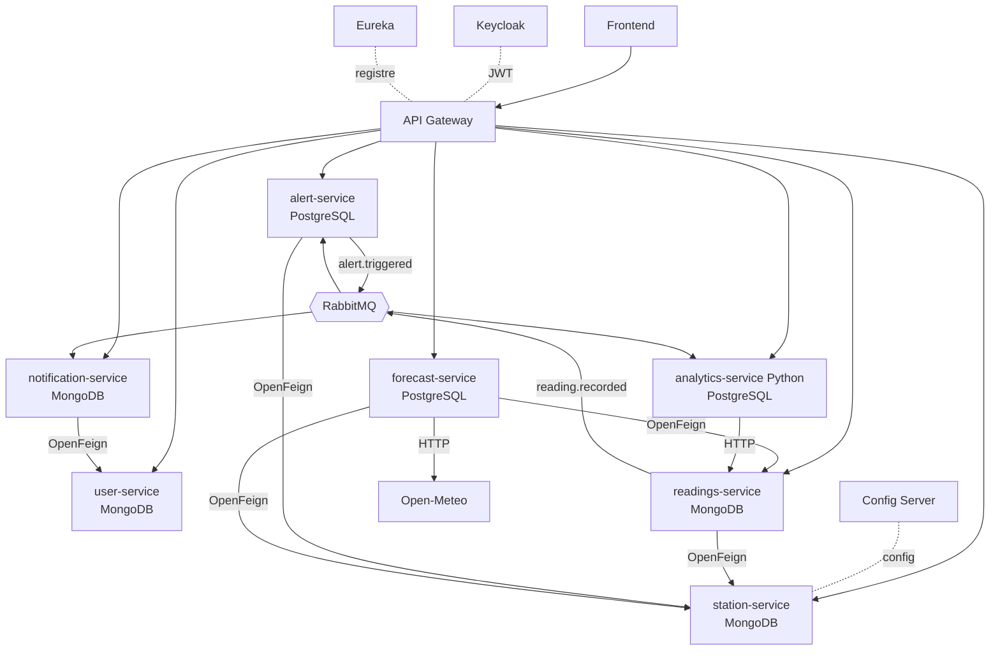

# MeteoWatch – Plateforme météo à base de microservices

> Projet AWD 2026-2027 – Validation 1 (conception microservices)
> Classe : 4XXX – Groupe : GX
> Enseignant (collaborateur du dépôt) : @...

## 1. Description du sujet
MeteoWatch collecte les relevés de stations météo, les compare aux prévisions, déclenche des alertes de vigilance (vert, jaune, orange, rouge) quand des seuils sont dépassés et notifie les utilisateurs abonnés à leur région. Un tableau de bord avec prédiction (Python) complète la plateforme.

**Acteurs :**
- **Visiteur / utilisateur connecté** : consulte prévisions et relevés, gère ses villes favorites et ses abonnements, lit ses notifications.
- **Administrateur** : gère les stations, capteurs, seuils d'alerte, modèles de messages.
- **Système externe** : API Open-Meteo (prévisions), serveur email / push.

## 2. Équipe et microservices

| Module | Membre | Microservice | Base de données | Port |
|---|---|---|---|---|
| 1 – Stations météo | Maha Hammami | `station-service` | MongoDB | 8081 |
| 2 – Alertes et vigilances | Linda Nebily | `alert-service` | PostgreSQL | 8082 |
| 3 – Utilisateurs et abonnements | Chaima Amri | `user-service` | MongoDB | 8083 |
| 4 – Relevés météo | Ramzi Ben Hmida | `readings-service` | MongoDB | 8084 |
| 5 – Prévisions | Amine Arfaoui | `forecast-service` | PostgreSQL | 8085 |
| 6 – Notifications | Mohamed Taher Elkhouja | `notification-service` | MongoDB | 8086 |
| 7 – Statistiques / tableau de bord (techno avancée, **commun**) | Toute l'équipe | `analytics-service` (Python) | PostgreSQL | 8087 |

Chaque README dans `Backend/<service>/` détaille le modèle de données, l'API et les interactions du service.
Outil de gestion de projet : _GitHub Projects / Trello – lien_

## 3. Fonctionnalités principales
- Gestion des stations et capteurs, recherche par ville ou région
- Enregistrement et historique des relevés, statistiques journalières
- Seuils, niveaux de vigilance, cycle de vie des alertes
- Profil, villes favorites, abonnements par région et canal
- Prévisions 1 à 7 jours (Open-Meteo) et comparaison avec le réel
- Notifications (email, push) avec historique lue / non lue
- Tableau de bord et prédiction

## 4. Architecture globale



Composants : Frontend, API Gateway, Eureka, Config Server, Keycloak, RabbitMQ, 7 microservices (une base chacun, aucune base partagée), Docker. Version image à déposer dans `Documentation/Diagrams/architecture-globale.png`.

## 5. Interactions entre services

| Appelant | Appelé | Mode | Données | Justification |
|---|---|---|---|---|
| readings-service | station-service | OpenFeign (sync) | existence de la station | réponse immédiate nécessaire pour valider |
| readings-service | alert-service, analytics-service | async `reading.recorded` | relevé | ne pas bloquer l'enregistrement |
| alert-service | station-service | OpenFeign (sync) | région | enrichir l'alerte |
| alert-service | notification-service | async `alert.triggered` | niveau, région, valeur | découplage, pas de perte si panne |
| notification-service | user-service | OpenFeign (sync) | abonnés + canaux | besoin du résultat pour envoyer |
| forecast-service | readings-service, station-service | OpenFeign (sync) | relevés, coordonnées | comparaison à la demande |
| forecast-service | Open-Meteo | HTTP (sync) | prévisions | source externe |
| analytics-service | readings-service, alert-service | async + HTTP | relevés, alertes | statistiques et entraînement |

Pannes : fallback OpenFeign (Resilience4j) côté appelant, files RabbitMQ persistantes pour l'asynchrone.

## 6. Technologies
Spring Boot, Spring Cloud (Gateway, Eureka, Config Server, OpenFeign), Keycloak, RabbitMQ, PostgreSQL, MongoDB, Python FastAPI + scikit-learn, Docker, Frontend (Angular / React à confirmer).

## 7. Structure du dépôt
```
├── Backend/
│   ├── station-service/  alert-service/  user-service/
│   ├── readings-service/ forecast-service/ notification-service/
│   └── analytics-service/        # Python, module commun
├── Frontend/
├── Documentation/
│   ├── Presentation/
│   ├── Diagrams/
│   └── CHECKLIST.md
├── CONTRIBUTING.md               # règles Git (à lire en premier)
└── README.md
```

## 8. Lancement
```bash
# Java : JDK 17+, Maven ; Python : 3.11+ ; Docker
cd Backend/<service> && mvn spring-boot:run          # services Spring
cd Backend/analytics-service && uvicorn app.main:app --port 8087
docker compose up                                      # une fois le compose ajouté
```

## 9. Planning prévisionnel et risques
_À compléter (semaines, jalons). Risques : intégration entre services, quota Open-Meteo, configuration Keycloak, temps d'apprentissage Python/IA._
